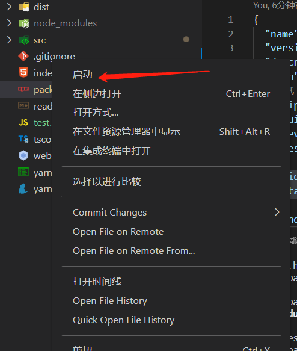
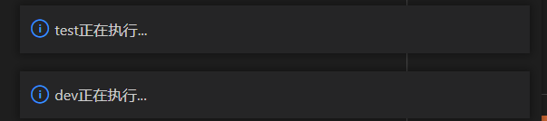

# rapid-tools

面向 Vue / JS 日常开发的 VSCode 提效插件：**代码理解面板**把「这个文件做什么、从哪里进入、数据怎么变化」放到首屏并支持点击跳转；另附简繁转换、选区简转 EN、i18n 悬停对照与启动脚本快捷菜单。

要求 VSCode ≥ 1.100。

## 快速开始

1. 安装插件后重载窗口。
2. 打开任意 `.vue` 或 `.js` 文件，点击左侧活动栏的「代码理解」图标，打开侧边栏视图「单文件导读」——**无需任何配置**，离线分析即可用。
3. 想用 AI 解读或「简体转 EN」时，在设置里搜 `AI`，填好 `AI.baseUrl` 与 `AI.model`，并把 `AI.enable` 打开（见 [大模型配置](#六配置项速查)）。

## 功能与入口一览

| 功能 | 怎么触发 | 默认状态 |
| --- | --- | --- |
| 代码理解面板 | 活动栏「代码理解」→ 视图「单文件导读」 | 可直接用（离线） |
| 手动刷新面板 | 面板顶部「刷新」；或编辑器右键「刷新代码导航」 | 可直接用 |
| AI 解读 | 面板内「生成解读」；函数卡片 / 状态流转行的「AI」按钮 | 需打开 `AI.enable` 并配好网关 |
| 简繁转换 | 编辑器右键「繁体转简体 / 简体转繁体」 | 需打开 `Converter.ctEnable` |
| 选区简体转 EN | 选中文本 → 编辑器右键「简体转 EN」 | 需配好网关 |
| i18n 悬停对照 | 在代码里悬停国际化 key | 需打开 `I18n.enable` |
| 启动脚本快捷菜单 | 资源管理器右键「启动」 | 需先配置 `rapidMenus` |

---

## 一、代码理解面板

### 1.1 怎么用

1. 打开 `.vue` / `.js` 文件，点活动栏「代码理解」图标。切换文件时面板会自动更新一次。
2. 默认停在 **「阅读路径」** Tab，从上往下读即可：先看结构摘要和关键入口与路径，再往下看状态、契约与函数。
3. 面板里凡是带行号的内容都可以点，**点击直接跳到源码对应位置**。
4. 顶部可切换阅读重点：
   - 「了解文件」——通读一遍用，信息最全。
   - 「准备修改函数」——只保留定位与关系，适合改代码前快速确认影响范围。
5. 需要完整清单或跳转某个符号时切到 **「完整结构」** Tab。
6. 内容有改动后点面板顶部「刷新」，或在编辑器右键「刷新代码导航」。

### 1.2 「阅读路径」Tab 有什么

- **先看脉络**：结构摘要，加上关键入口与路径（模板入口或文件入口 → 触发 / 调用 / 写入 / 导出 / 返回），每步带行号。
- **关键状态**：可定位的状态声明与写入点。
- **待办与备注**：文件里的 TODO / FIXME / HACK 等注释原文。
- **组件契约**：`props`（是否必填）、`emits`（是否已在 `emits` 声明、本文件内的触发点）、`slots`（含作用域插槽）、`provide / inject`。
- **状态流转 · 谁读谁写**：每个状态被谁读、被谁写、被哪些模板行引用。
- **初始化与生命周期 · 顺序推定**：`state` / `computed` / `watch` / `hook` 按源码出现位置排序，**不代表运行时真实执行顺序**。
- **函数卡片 · 签名与影响面**：签名、`async`、返回值与错误处理标记，以及这个函数「被谁调用 / 调用了谁 / 写入了哪些状态」。

### 1.3 「完整结构」Tab 有什么

- **模板组件树**：`<template>` 解析成的组件嵌套树，默认展开；展开时会自动补载更深层的子节点。
- 导出、导入、函数与声明、Props、状态、Computed、Watch、生命周期，以及按命名规则聚合的语义分组。
- TODO 与备注、解析提示（解析失败时降级展示可识别的内容与报错原因，不会白屏）。

### 1.4 用 AI 解读（可选）

1. 按 [大模型配置](#六配置项速查) 填好 `AI.baseUrl`、`AI.model`，并把 `AI.enable` 打开。
2. **整文件解读**：在「阅读路径」顶部点「生成解读」，稍后区块内就地显示结果。
3. **单节点解读**：函数卡片或状态流转行右上角点「AI」，只解释这一个节点，点一次请求一次。
4. 解读结果里带行号的引用可以直接点击跳回源码；不满意可点「重新生成」。

使用提示：

- 解读刻意写得短（文件级几句话、节点级两三句），拿来快速把握重点，需要细节仍建议直接读源码。
- 结果按 markdown 排版，代码片段会按语言着色；带虚线边框和「AI 推断」角标的才是模型输出，与作者原话明显区分。
- 结论中提到的行号都经过校验，指向源码里真实存在的结构，不会出现跳不过去的链接。
- `AI.enable` 关闭时面板完全不联网，行为和纯离线版本一致。
- 同一文件重复生成会命中缓存，不必担心反复计费；文件或模型配置变化后会自动失效重取。

### 1.5 它明确不做什么

- **不跨文件**：`imports` 只列出本文件引用了哪些本地组件 / 工具；调用与读写关系只认本文件能确认的部分，不做全库分析。
- **不推断运行时调用链**：顺序由源码位置推定，动态调用与框架注入会标注「未确认」。
- **不改代码**：面板只读分析，不会改动业务代码，也不会写入语言包等其他文件。

---

## 二、简繁转换

1. 设置里搜 `Converter.ctEnable` 并勾选。
2. 在编辑器里右键，选择「繁体转简体」或「简体转繁体」（命令面板里也能搜到）。
3. 有选区时只转换选区，**没选区时转换整篇文档**。
4. 转换过程可随时取消，**取消时不会写回**，不会用半成品覆盖原文。

繁体风格由 `Converter.ctType` 决定：`hk`（香港）、`tw`（台湾，含惯用词转换）、`traditional`（标准繁体）。

## 三、选区简体转 EN

1. 选中一段中文。
2. 右键 →「简体转 EN」，翻译结果会**就地替换选区**。
3. 需要先配好大模型（`AI.baseUrl` + `AI.model`）；提示词由 `Converter.enLabel` 提供。

菜单只在有选区时出现；未配置网关或提示词时会直接提示原因，不会发出请求。

## 四、i18n 悬停对照

1. 设置里搜 `I18n.enable` 并勾选。
2. 在符合 `I18n.validPath` 的文件里，把鼠标悬停在国际化 key 上，即可看到各语言文案对照（默认中 / 英）。

| 配置 | 说明 |
| --- | --- |
| `I18n.langs` | 启用的语言标识，语言文件位于 `basePath/标识`；**第一个语言作为基准语言** |
| `I18n.basePath` | 语言文件基础目录（相对工作区根目录） |
| `I18n.validPath` | 悬停生效的文件 glob；留空则关闭悬停 |

## 五、启动脚本快捷菜单（rapidMenus）

把「调试这个项目要先跑哪几条命令」固化下来，一键开终端执行。

### 1）在工作区 settings.json 中配置

```json
"rapidMenus": {
    "startup": "xxx1 && xxx2"
}
```

或使用对象写法：

```json
"rapidMenus": {
    "startup": {
        "script": "dev && test",
        "watch": {
            "link_script": "dev",
            "files": ["./test.js"]
        }
    }
}
```

> 可执行的是当前工作区 `package.json` 的 `scripts` 里的命令名（这里只读取脚本名，菜单配置本身来自 settings.json）。未配置时资源管理器不会出现「启动」菜单；改完配置会自动重新初始化，无需重载窗口。

### 2）在左侧视图栏右键选择「启动」



### 3）启动提醒

脚本按 `&&` 拆分，每条命令各自打开一个终端执行 `npm run <name>`，并给出提示：



---

## 六、配置项速查

### 大模型（简转 EN 与 AI 解读共用同一组）

| 配置 | 默认 | 说明 |
| --- | --- | --- |
| `AI.baseUrl` | `""` | 接口地址，OpenAI 兼容（如 `https://host/v1/chat/completions`） |
| `AI.model` | `""` | 模型名 |
| `AI.apiKey` | `""` | 按 `Authorization: Bearer` 发送；内网网关无需鉴权时留空 |
| `AI.enable` | `false` | 代码理解面板的 AI 解读开关；关闭时不发起任何请求 |

`AI.baseUrl` 与 `AI.model` 必须配置，`apiKey` 可留空；`AI.*` 任一项变化时面板即时刷新，无需重载窗口。

> **迁移**：早期版本的 `Converter.enUrl`、`Converter.AIModel`、`CodeNav.aiModel`、`CodeNav.aiEnable` 已移除，请改用上表的 `AI.baseUrl` / `AI.model` / `AI.enable`；`Converter.enLabel` 保留不变。

### 其他

| 配置 | 默认 | 说明 |
| --- | --- | --- |
| `Converter.ctEnable` | `false` | 简繁转换总开关 |
| `Converter.ctType` | `"tw"` | 繁体类型：`hk` / `tw` / `traditional` |
| `Converter.enLabel` | 见设置面板 | 简转 EN 的提示词 |
| `I18n.enable` | `false` | i18n 悬停提示总开关 |
| `I18n.langs` | `["cn", "en"]` | 启用的语言标识 |
| `I18n.basePath` | `"src/i18n"` | 语言文件基础目录 |
| `I18n.validPath` | `"**/src/**"` | 悬停提示生效的文件 glob |

## 附：源码与本地开发

```bash
yarn install
yarn compile        # webpack 打包到 dist/
yarn watch          # 开发态增量编译
yarn lint           # eslint src --ext ts
yarn test           # 编译 + 打包 + lint + Electron 宿主内跑全量测试
```

内核分析结果可以脱离编辑器直接查看：

```bash
yarn code-nav:analyze path/to/file.vue   # 输出单文件分析的 JSON
```

设计与协议文档见 `docs/`。
